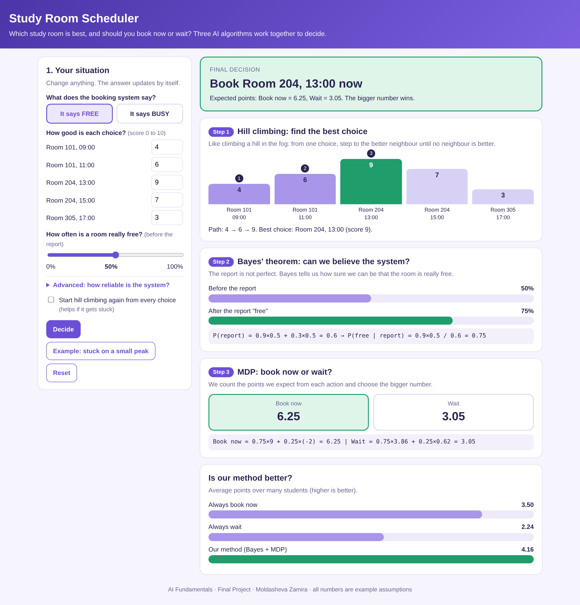

# Study Room Scheduler

AI Fundamentals · Final Project · Author: **Moldasheva Zamira** (individual project)

A small web app that helps a student decide **which study room to take and whether to book now or wait**,
when the booking system says "free" or "busy" but its information is often out of date.



## Three AI topics working together

| Step | Course topic | Algorithm | What it does here |
|---|---|---|---|
| 1 | Local search | **Hill climbing** | finds the best room/time by its score |
| 2 | Probabilistic reasoning | **Bayes' theorem** | how sure are we that the room is really free after the report? |
| 3 | Sequential decisions | **MDP (one Bellman update)** | chooses *Book now* or *Wait* |

They are connected: hill climbing gives the **reward** (score of the best room), Bayes gives the **probability**,
and the MDP uses both to make the final decision.

## How to run (Windows / Mac / Linux)

You need Python 3.9 or newer.

```bash
pip install -r requirements.txt
python app.py
```

Open **http://127.0.0.1:5000** in your browser. Change any input and the answer updates by itself.

Only the algorithms, in the terminal: `python scheduler.py`

## How to run the tests

```bash
python -m pytest
```

43 tests: hill climbing, Bayes, MDP, the whole chain, input checks and the web API.

## Project files

| File | Purpose |
|---|---|
| `scheduler.py` | the three algorithms and the whole chain (no web code) |
| `app.py` | small Flask web server (`/` page and `/api/decide`) |
| `templates/index.html` | the user interface |
| `tests/` | automatic tests |
| `docs/` | screenshots |

## Input and output

* **Input:** what the system says (free / busy), a score for each of the 5 choices, how often a room is really free,
  how reliable the system is.
* **Output:** the final decision, the steps of each algorithm with the numbers, and a comparison with two simple strategies.

All probabilities and rewards are **example assumptions** (listed in `Settings` in `scheduler.py`).

## Results (default settings)

| Report | P(room really free) | Book now | Wait | Decision |
|---|---:|---:|---:|---|
| free | 0.75 | 6.25 | 3.05 | **Book now** |
| busy | 0.125 | −0.625 | 1.025 | **Wait** |

Average reward (higher is better): always book **3.50**, always wait **2.24**, our method **4.16**.

## Limitations and future work

* Only 5 choices and one report; the numbers are invented, not measured.
* Hill climbing can get stuck on a small peak (try *Example: stuck on a small peak*). The option
  *Start hill climbing again from every choice* fixes it.
* Next steps: real booking data, repeated reports over time (hidden Markov model), learning the rewards (Q-learning).

## AI usage declaration

I used Claude (Anthropic) as a helper to plan the project, write and comment the code and tests, and draft the documents.
I ran the application and the tests myself, checked the numbers by hand, and I can explain every part.

## Team contribution

Individual project. All parts (idea, code, tests, report, presentation, demo) were done by Moldasheva Zamira.
